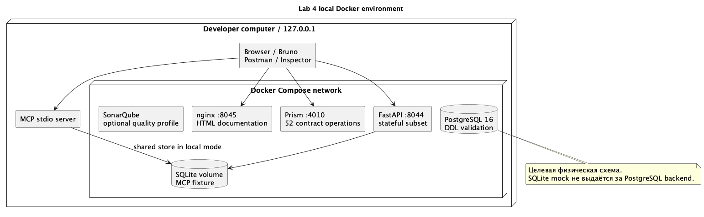

# Инфраструктура и организация работы

## Локальное окружение

Docker Compose поднимает stateful API, Prism, PostgreSQL и nginx с документацией. API и PostgreSQL имеют healthcheck. Порты API, mock и web привязаны к 127.0.0.1, PostgreSQL не публикуется на хосте. SQLite и PostgreSQL используют разные volumes. Сервисы не обращаются к реальным файлам пользователя.

Содержимое web ограничено каталогом web с опубликованными материалами. Виртуальное окружение, локальная база и переменные окружения через nginx не раздаются. В Dockerfile приложение работает от непривилегированного пользователя. Для остановки используется docker compose down; данные остаются в volumes.

## Непрерывная интеграция

Workflow lab4.yml запускает Ruff, pytest с порогом покрытия 70%, генерирует OpenAPI из исходников и валидирует документ. Только после тестов строится Docker-образ. Затем выполняются проверки PostgreSQL, всех операций Prism, коллекции Bruno и MCP через SDK и официальный Inspector. Протоколы сохраняются как GitHub Actions artifact.

Шаг SonarCloud подготовлен отдельно и включается при наличии переменных SONAR_PROJECT_KEY, SONAR_ORGANIZATION и секрета SONAR_TOKEN. Без них он пропускается. Файл sonar-project.properties и необязательный сервис SonarQube в профиле quality предоставляют локальную конфигурацию. Для включения облачного Quality Gate нужно создать проект в соответствующем сервисе и настроить блокировку слияния при неуспехе проверки.

## Репозитории и ветки

Основной приватный репозиторий hci-10-project-group-4 хранит учебные материалы и воспроизводимый прототип ЛР4. Публичный GremlinDrive содержит сайт и экспорт документации. При проверке GitHub доступны также hci-10-frontend-group-3 и hci-10-mobile-group-3, оба пустые. Их содержимое и принадлежность не подменялись новым кодом. Отдельного backend-репозитория GremlinDrive среди доступных репозиториев организации не обнаружено.

Предлагаемое правило дальнейшей разработки: feature-ветки от development, проверка pull request, затем перенос проверенной версии в production. Изменение существующих правил защиты и создание новых репозиториев требуют согласования в команде. Для текущей лабораторной результаты оформлены одним набором файлов и проверяются CI.

## План следующего этапа

| Этап | Задача | Роль | Критерий завершения |
|---|---|---|---|
| API | Перенос stateful-сценариев на NestJS и PostgreSQL | Backend | Повторно проходят сценарии ссылок, корзины и квот |
| Файлы | Загрузка частями, MinIO, проверка checksum и карантин | Backend | Обрыв и возобновление без потери частей |
| Web | Подключение React к OpenAPI | Web | Вход, файловый список и диалог ссылки работают с API |
| Mobile | Сессии, фоновая очередь и офлайн-кэш | Mobile | Загрузка продолжается после восстановления сети |
| Качество | SonarCloud, развёртывание и защита веток | DevOps | Успешный pipeline и проверяемый адрес backend |

## Вклад участников

Матвей Вержбиба подготовил требования, User Stories, UML и архитектуру ЛР3; исходный коммит 392a849 сохранён в истории. Александр Сытин выполнил ЛР4: трассировку требований, DDL, контракт и коллекции, stateful mock, MCP MVP, тесты, контейнеры и документацию. Работа других участников в рамках ЛР4 не приписывается.

## Проверка при защите

Сначала открыть PDF и страницу лабораторной. Показать связь US-03 → UC-09 → POST share-links, затем физическую модель и schema.sql. В Bruno запустить окружение contract, в Swagger mock показать запрет публикации для reader и успешное создание ссылки владельцем. Через Inspector показать tools/list, ресурс gremlin://policy и вызов list_files. В конце открыть протоколы тестов и workflow CI.
