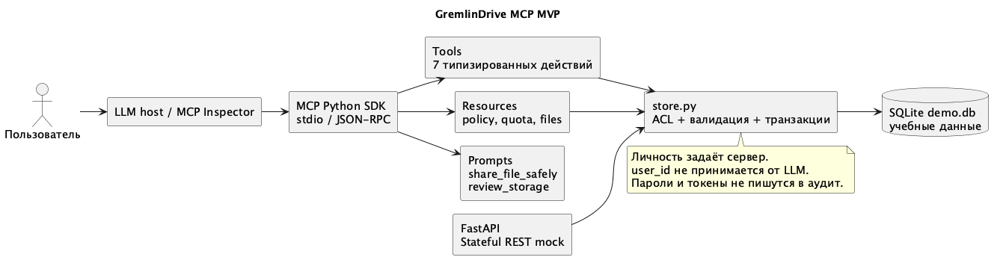

# MCP сервер GremlinDrive

Сервер позволяет ассистенту находить доступные файлы, читать метаданные, создавать папки и защищённые ссылки, отзывать ссылки и работать с корзиной. Используется официальный MCP Python SDK 1.30.0 и транспорт stdio. Учебная база SQLite общая с REST mock при одинаковом GREMLIN_DB.

## Запуск

```bash
cd docs/labs/lab4/runtime
python3.12 -m venv .venv
.venv/bin/pip install -r requirements.txt
GREMLIN_USER_ID=00000000-0000-4000-8000-000000000001 .venv/bin/python mcp_server.py
```

Вывод stdout занят JSON-RPC. Диагностика направляется в stderr. В обычном терминале сервер ожидает клиента; для проверки используется Inspector.

```bash
MCP_AUTO_OPEN_ENABLED=false npx --yes @modelcontextprotocol/inspector --cli   .venv/bin/python mcp_server.py --method tools/list
.venv/bin/python test_mcp.py
```

## Архитектура



Личность пользователя задаёт окружение процесса GREMLIN_USER_ID. Инструменты не принимают user_id от LLM. Каждое действие проходит проверки доступа в store.py. Пользователь с ролью просмотра не может создать ссылку или удалить файл. SQLite содержит только демонстрационные записи и не заменяет промышленную PostgreSQL-схему.

## Tools

| Инструмент | Параметры | Результат и ограничения |
|---|---|---|
| list_files | query, limit 1–100 | Доступные активные файлы |
| get_file | file_id UUID | Метаданные с проверкой ACL |
| create_folder | name, parent_id UUID или null | Новая папка; нужна запись в родительскую |
| create_share_link | file_id UUID, password от 8 символов, expires_in_days 1–30 или null (по умолчанию 14), access_level view/download | Ссылка на активный файл |
| revoke_share_link | share_id UUID | Отзыв при праве записи на файл |
| trash_file | file_id UUID, confirm=true | Корзина и отзыв ссылок |
| restore_file | file_id UUID | Возврат из корзины без публикации старых ссылок |

Полные JSON-схемы inputSchema и outputSchema получены через tools/list, а не написаны вручную: evidence/mcp-protocol.json и evidence/inspector-tools.json. Некорректный UUID и confirm=false отклоняются до выполнения действия.

## Resources

Статические адреса gremlin://policy, gremlin://quota и gremlin://files/recent дают правила, текущую квоту и список доступных файлов. В MVP recent возвращает первые 20 файлов, отсортированных по имени; сортировка по времени добавляется при подключении PostgreSQL. Шаблон gremlin://files/{file_id} предоставляет метаданные конкретного файла с проверкой доступа.

## Prompts

share_file_safely(filename) задаёт последовательность: прочитать правила, найти файл, уточнить выбор, получить пароль и срок, создать ссылку. review_storage читает квоту и доступные файлы, после чего предлагает варианты очистки. Промпт не выдаёт полномочий: проверки в сервисе выполняются независимо от текста запроса.

Пример запроса пользователя: «Найди Лабораторная.txt и подготовь ссылку на семь дней с паролем». Ассистент получает UUID через list_files и уточняет параметры до create_share_link. Другой пример: «Покажи занятую квоту и предложи, что убрать в корзину». Здесь чтение выполняется сразу, а перенос требует выбранных file_id и confirm=true.

## Подключение к клиенту

В конфигурации MCP клиента указываются command с абсолютным путём к .venv/bin/python, args с абсолютным путём к mcp_server.py и env с GREMLIN_DB и GREMLIN_USER_ID. Шаблон находится в mcp-client.example.json. Реальные секреты и абсолютные пути пользователя в репозиторий не сохраняются.

## Проверка

test_mcp.py подключается как настоящий MCP-клиент по stdio, выполняет initialize, discovery, читает ресурсы и шаблон, получает оба промпта и вызывает все инструменты. Дополнительно проверяются отказ публикации для читателя, неверный UUID и отсутствие подтверждения. Официальный Inspector отдельно выполняет tools/list. Протоколы находятся в evidence.
