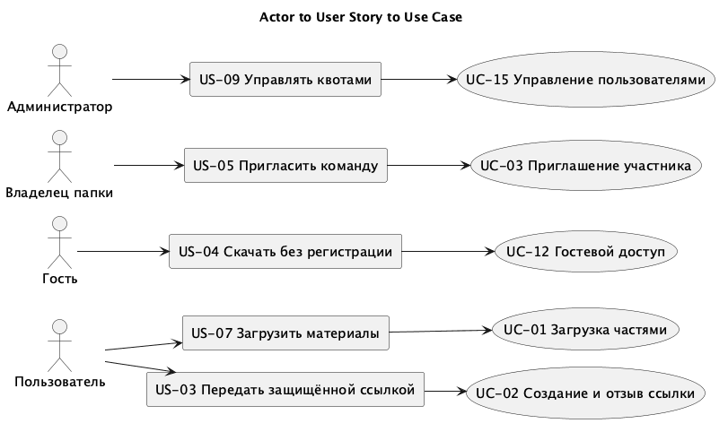

# Модель требований и реестр вариантов использования

Входной материал - SRS и User Stories лабораторной работы 3. Идентификаторы US-01–US-16, FR-01–FR-30 и UC-01–UC-05 сохранены. Первые пять UC описывают загрузку, ссылку, приглашение, восстановление версии и запрос прав или квоты. Для ЛР4 добавлены UC-06–UC-19 и связь с HTTP-операциями.

Действующее лицо задаёт цель через пользовательскую историю, вариант использования описывает действия и результат, а конечная точка предоставляет серверный контракт. Полная трассировка хранится в traceability.json.

| ID | Действующее лицо | User Story | Вариант использования | Результат |
|---|---|---|---|---|
| UC-01 | Пользователь | US-07 | Загрузка файла частями | После завершения создана версия и начата проверка |
| UC-02 | Пользователь | US-03, US-16 | Создание, просмотр и отзыв ссылок | Управляемый доступ к активному файлу |
| UC-03 | Владелец папки | US-05 | Приглашение и принятие приглашения | Участник добавлен с выбранной ролью |
| UC-04 | Участник папки | US-06 | Просмотр и восстановление версий | Восстановление создаёт следующую версию |
| UC-05 | Пользователь и администратор | US-10, US-15 | Запрос и решение по квоте | Решение применяется однократно в транзакции |
| UC-06 | Гость | US-01 | Регистрация и подтверждение e-mail | Аккаунт активирован после проверки адреса |
| UC-07 | Пользователь | US-02 | Вход, выход и восстановление доступа | Сессия выдана или отозвана |
| UC-08 | Пользователь | US-12 | Настройка и проверка TOTP | Вход требует второй фактор |
| UC-09 | Пользователь | US-07 | Работа с файлами и папками | Создана папка или изменено имя файла |
| UC-10 | Пользователь | US-06, US-07 | Поиск, метаданные и скачивание | Возвращены только доступные объекты |
| UC-11 | Пользователь | US-11 | Корзина и восстановление | Файл восстановлен без активации старых ссылок |
| UC-12 | Гость | US-04 | Открытие ссылки и скачивание | Пароль, срок и уровень доступа проверены |
| UC-13 | Владелец папки | US-05 | Изменение роли и удаление участника | Новые права применены при следующем запросе |
| UC-14 | Участник папки | US-13 | Комментарии и уведомления | Комментарий сохранён, уведомление доступно адресату |
| UC-15 | Администратор | US-09 | Пользователи, роли и квоты | Изменение проверено и записано в аудит |
| UC-16 | Администратор | US-14 | Аудит и экспорт отчётов | Получен журнал или задача формирования отчёта |
| UC-17 | Мобильный пользователь | US-07, US-08 | Push, фоновая загрузка и синхронизация | Клиент получил изменения после восстановления сети |
| UC-18 | Администратор | US-09 | Запуск синхронизации LDAP | Сформирован результат синхронизации каталога |
| UC-19 | Разработчик | US-09 | Проверка окружения | Получен статус работоспособности mock-сервиса |

## Уточнения требований для API

API-01. Каждый защищённый запрос устанавливает пользователя по сессии. Идентификатор пользователя из тела запроса не меняет действующее лицо. Право администратора не даёт права читать содержимое личных файлов.

API-02. Ссылка не раскрывает метаданные до проверки пароля. После пяти неверных попыток доступ к этой ссылке блокируется на 15 минут, как предусмотрено US-03. Срок по умолчанию 14 дней, null задаёт бессрочную ссылку. При истечении срока или отзыве возвращается нейтральная ошибка.

API-03. Перенос в корзину отзывает ссылки. Восстановление файла не публикует его повторно. Карантин запрещает публикацию.

API-04. Завершение загрузки идемпотентно по ключу операции. Квота резервируется до передачи данных, а занятый объём меняется в транзакции. Эти операции описаны контрактом; передачу бинарных частей в stateful mock заменяют ответы Prism.

API-05. Выбор версии при восстановлении создаёт новую версию, не переписывая старую. Параллельная запись контролируется версией объекта или If-Match.

API-06. Клиент получает коды 401, 403, 404, 409, 422 и 429 с понятной причиной. Пароли, хеши и токены не попадают в обычные ответы списка и журнал аудита.

API-07. Тёмная тема, биометрия и офлайн-кэш относятся к клиенту. Сервер предоставляет сессию, метаданные, контент и синхронизацию; биометрические данные на сервер не отправляются. FR-28 проверяется при реализации интерфейса, а не отдельным endpoint.

## Подробные сценарии

### UC-02 Передача файла по ссылке

Предусловие: пользователь вошёл, файл активен, у пользователя есть право редактирования. Клиент отправляет file_id, access_level, пароль и срок. Сервер проверяет права и состояние файла, создаёт случайный токен, сохраняет его хеш и хеш пароля, затем возвращает 201 с URL и датой окончания. Повторно секретный токен в списке ссылок не показывается. При недостаточных правах возвращается 403, при корзине или карантине - 409, при коротком пароле - 422. Отзыв ссылки изменяет её состояние и записывается в аудит.

### UC-12 Открытие гостевой ссылки

Предусловие: гость получил URL. Клиент отправляет пароль в POST access. После проверки сервер выдаёт краткоживущий токен доступа и метаданные. Скачивание требует этот токен и уровень download. При view скачивание отклоняется с 403. При неверном пароле возвращается 401, после пяти ошибок - 429. Истёкшая или отозванная ссылка возвращает 404 без имени файла.

### UC-01 Загрузка файла частями

Пользователь выбирает файл и папку. Клиент создаёт upload session с размером и ключом идемпотентности, получает id и передаёт части по номеру. После обрыва запрашивается принятый объём. Завершение сверяет размер и checksum, фиксирует версию и отправляет задачу на проверку. Недостаток квоты даёт 507, неверная контрольная сумма - 409. Состояние остаётся pending до успешной проверки.

### UC-05 Решение по запросу квоты

Пользователь отправляет обоснование и требуемый объём. Администратор открывает очередь, выбирает запрос и указывает новую квоту либо причину отказа. Сервер блокирует запись запроса, проверяет pending, меняет квоту и сохраняет решение одной транзакцией. Повторное решение даёт 409. Уменьшение ниже занятого объёма запрещено.

### UC-11 Восстановление из корзины

Пользователь выбирает собственный файл в корзине и вызывает POST restorations. Сервер проверяет право записи и состояние, переводит файл в active и записывает событие. Ранее отозванные ссылки остаются недействительными. Попытка восстановить активный файл даёт 409.
