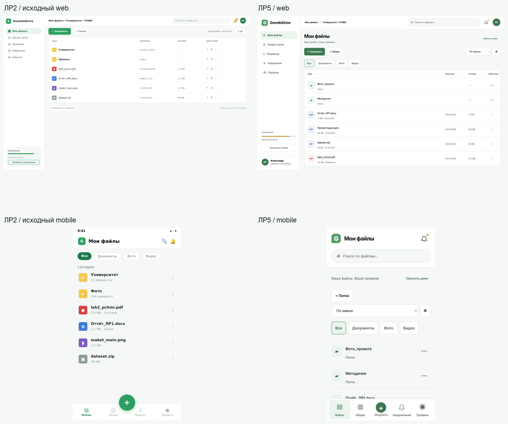
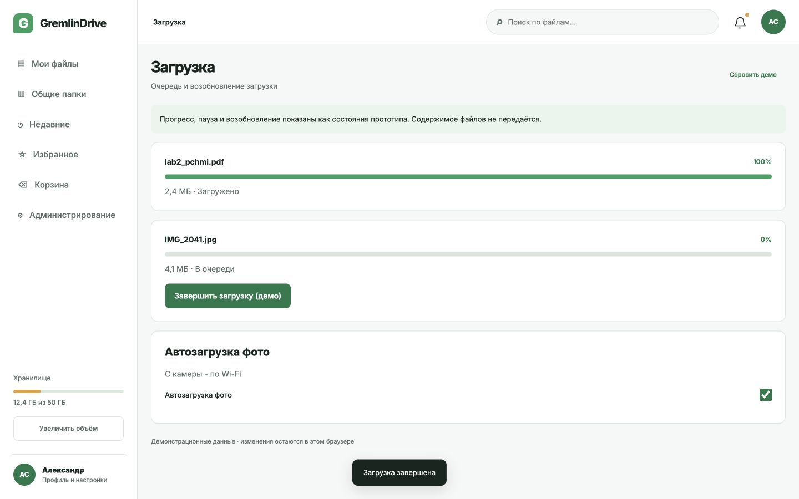
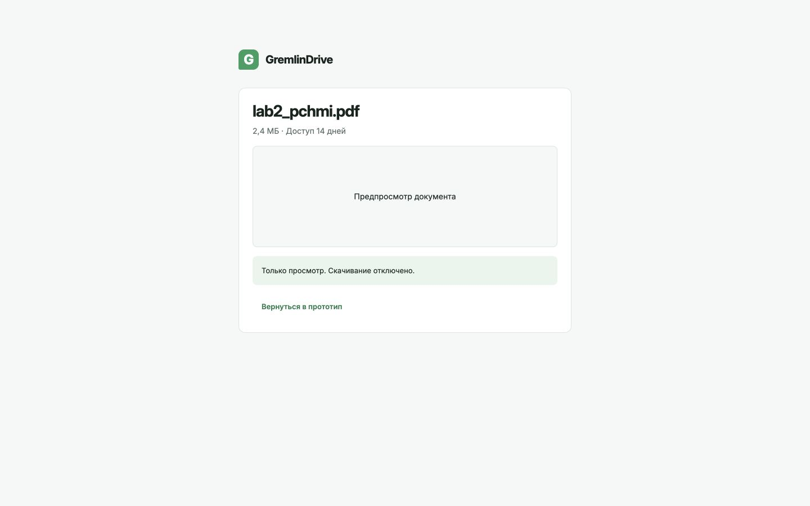
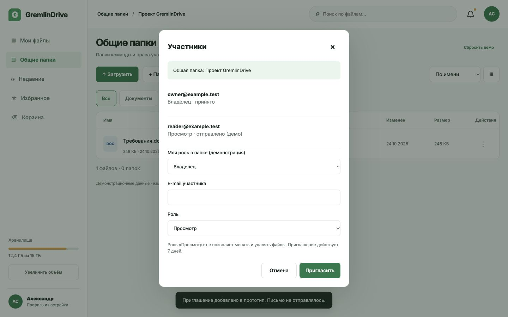
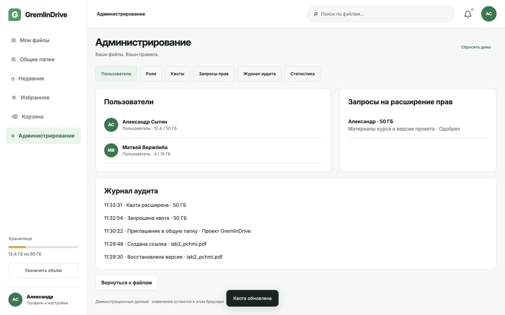

# 1 Цель и исходные материалы

Цель работы - развить визуальное решение GremlinDrive из ЛР2 в интерактивный веб- и мобильный прототип. За основу взяты исходные отчёты и LaTeX-файлы ЛР1-2 команды, SRS и модели ЛР3 Матвея Вержбибы из коммита 392a849, а также контракт API ЛР4. Методические указания ЛР5 взяты из задания №575 на учебном портале, проверенного 24.10.2026.

В ЛР1 описаны разные сценарии личного и командного хранения. Поэтому интерфейс сохраняет понятные имена файлов, совместную работу через общие папки, отдельный гостевой просмотр и запрос расширения квоты. Исходные результаты опроса ЛР1 не используются как оценки нового прототипа.

Для дополнительного учебного задания подготовлен набор оценок 15 смоделированных профилей S01-S15. Это моделирование, а не опрос людей. Все исходные строки имеют data_origin=synthetic; способ расчёта и зерно 20261024 открыты в scripts/model_study.py. Результаты показывают работу метода и не доказывают предпочтения аудитории.

# 2 Преемственность информационной архитектуры и дизайна

В ЛР2 уже выбраны Inter, основной зелёный #2E9E62, фон #F6F8F7, предупреждение #E5A13B и отступы по сетке 8 pt. Эти решения сохранены. На веб-экране 1440 px используется боковая панель и рабочая область с интервалами 24 px. Для мобильного варианта исходной точкой остаётся размер 375×670 px.

Веб-навигация состоит из разделов «Мои файлы», «Общие папки», «Недавние», «Избранное», «Корзина». На телефоне снизу находятся «Файлы», «Общие», центральное действие загрузки, «Уведомления», «Профиль». Недавние, избранное и корзина доступны из профиля. Общие папки содержат участников и роли, а публичные ссылки создаются отдельно в карточке файла.

Смысл UC-01-UC-05 из ЛР3 сохранён в ЛР4-6. Загрузка относится к UC-01, создание ссылки - к UC-02, приглашение - к UC-03, восстановление версии - к UC-04, запрос квоты или прав - к UC-05. Развёрнутая таблица преемственности включена в общий файл CONTINUITY.md.

# 3 Варианты визуального языка

Сравниваются три оттенка исходного зелёного решения при одинаковой композиции. Brand сохраняет #2E9E62, Contrast использует более тёмный #1F7A4B для кнопок с белым текстом, Emerald - #087F63. Положение элементов, подписи и данные одинаковы; меняется только акцентная палитра. Варианты доступны через theme=brand, theme=contrast и theme=emerald.

При выборе важны спокойствие, читаемость, порядок и доверие. Разделение личного и командного хранения опирается на ЛР2; ради сравнения цветов навигация не менялась. Контраст проверяется отдельно от субъективной модели оценок.

# 4 Семантический дифференциал

Использованы 15 пар прилагательных. Оценка 1 соответствует левому полюсу, 5 - правому, 3 - нейтральному впечатлению. Направление шкал одинаковое.

|№|Левый полюс: 1|Правый полюс: 5|
|---|---|---|
|1|сложный|простой|
|2|хаотичный|упорядоченный|
|3|перегруженный|лаконичный|
|4|устаревший|современный|
|5|неприятный|приятный|
|6|тусклый|выразительный|
|7|неуверенный|надёжный|
|8|чужой|привычный|
|9|тяжёлый|лёгкий|
|10|раздражающий|спокойный|
|11|нечитабельный|читабельный|
|12|непоследовательный|целостный|
|13|холодный|дружелюбный|
|14|отвлекающий|сосредоточенный|
|15|любительский|профессиональный|

Каждый профиль оценивает три палитры на двух платформах: 15 × 3 × 2 × 15 = 1350 оценок. Модель учитывает общий сдвиг оценок одного профиля, предпочтение палитры и случайный разброс. Профили повторяются между условиями, поэтому оценки связаны; статистическая значимость и выводы о населении не рассчитываются.

Среднее пары - сумма 15 оценок, делённая на 15. Итог палитры - среднее по всем 15 парам; на одной платформе он объединяет 225 значений. Правило выбора задано до сравнения: наибольшее общее среднее при выполнении проверки контраста основных элементов.

|Палитра|Web, 1-5|Mobile, 1-5|
|---|---|---|
|Brand #2E9E62|3.716|3.56|
|Contrast #1F7A4B|4.133|3.969|
|Emerald #087F63|3.858|3.733|

В модели выбран Contrast на обеих платформах. Он сохраняет исходную зелёную гамму и даёт достаточный контраст белой подписи основной кнопки. Цвет #2E9E62 остаётся цветом марки и индикаторов; более тёмный оттенок используется там, где нужен обычный белый текст. Для проверки предпочтений этот выбор следует повторить с реальными участниками.

## 4.1 Индивидуальные средние

Средние в таблице объединяют две платформы и 15 шкал. Полные ответы каждого профиля сохранены в data/semantic.csv.

|Профиль|Brand|Contrast|Emerald|
|---|---|---|---|
|S01|3.3|4.1|3.8|
|S02|3.33|4.03|3.2|
|S03|4.03|4.33|3.97|
|S04|4|4.4|3.73|
|S05|3.87|4.53|4.13|
|S06|3.97|4.23|4.5|
|S07|3.2|4.13|3.63|
|S08|3.23|3.77|3.2|
|S09|3.7|3.43|3.5|
|S10|4.17|4.27|4.43|
|S11|3.57|3.9|3.57|
|S12|3.57|4.23|3.6|
|S13|3.73|4.2|3.93|
|S14|3.6|3.77|3.97|
|S15|3.3|3.43|3.77|

# 5 Сценарии интерактивного прототипа

Прототип выполнен на HTML, CSS и JavaScript. Он показывает взаимодействие, состояния и ограничения; целевые React и React Native из ЛР3 остаются этапом реализации. В ЛР4 серверный mock написан на Python/SQLite, а NestJS, PostgreSQL и MinIO описывают целевую архитектуру. Подмена одного стека другим не заявляется.

## 5.1 Вход и загрузка

Вход проверяет формат почты и пароль. Регистрация добавляет подтверждение пароля и демонстрационный переход к подтверждению почты с ограничением 24 часа. Настоящие учётные записи не создаются. Используются только тестовые реквизиты student@example.test и gremlin2026.

После входа пользователь открывает папку, ищет файл, меняет сортировку и вид списка. Пустое состояние предлагает изменить поиск. Новая папка требует непустого уникального имени до 80 символов. Загрузка показывает очередь, сохранённый прогресс, возобновление и уведомление о завершении. Выбор файла сохраняет метаданные; передача содержимого и камера в браузерном макете не реализованы.

## 5.2 Ссылка и гостевой доступ

В карточке файла сохранены вкладки «Предпросмотр», «Версии», «Комментарии», «Доступ». Ссылка разрешает просмотр либо просмотр и скачивание. По умолчанию выбран срок 14 дней; доступны 1, 7, 30 дней и бессрочный вариант. Необязательный пароль содержит от восьми символов. Ссылка и пароль копируются отдельно.

До проверки пароля гостевой экран не раскрывает название и размер защищённого файла. После проверки показывается предпросмотр; для режима «Только просмотр» кнопки скачивания нет. Ссылка действует на демонстрационное состояние в том же браузере, а не на объект реального хранилища. Серверный контракт использует 14 дней по умолчанию и null для бессрочного доступа. Истечение срока, отзыв бессрочной ссылки и ограничение попыток проверяются тестами ЛР4; браузерный макет не заменяет серверный контроль.

## 5.3 Общая папка, версии и квота

Приглашение создаётся в «Общие папки → Проект GremlinDrive → Участники». Роли «Просмотр» и «Редактирование» относятся к членству в папке. Читателю недоступны переименование, удаление и изменение ссылок. Приглашать участников может владелец. Демонстрационный переключатель роли нужен для проверки ограничений; письмо не отправляется.

Восстановление старой версии создаёт следующую версию и сохраняет историю. Например, после восстановления версии 1 при существующих 1 и 2 появляется текущая версия 3 с указанием источника. В корзине файл можно вернуть в исходную папку, но отозванные при удалении ссылки сами не активируются.

Квота открывается через профиль. Пользователь указывает новый объём и причину, администратор одобряет или отклоняет запрос с обоснованием. Демонстрационный код 000000 иллюстрирует отдельный административный вход. После решения обновляются квота, уведомления и аудит; повторного действия нет.

Для офлайн-сценария предусмотрена отметка файла и режим «Нет сети». Доступен только отмеченный файл, сетевые изменения заблокированы. Это проверка состояний интерфейса; шифрованный кэш и системная биометрия в HTML-прототип не входят.

# 6 Адаптивность

Проверены шесть веб-ширин: 1440, 1100, 900, 650, 480 и 360 CSS px. Они покрывают все диапазоны методических указаний. Мобильные размеры: 375×670, 390×844, 412×915, 768×1024 и 1024×1366. Первый совпадает с исходным макетом ЛР2; два последних представляют планшетные раскладки.

Снимки сделаны при явном размере viewport встроенного браузера, без масштабирования iframe. В ../lab6/data/layout-checks.json сохранены измерения ширины документа и кнопок. Во всех 11 случаях нет горизонтального переполнения; кнопки действий имеют область от 44×44 px. При ширине до 767 px боковая панель заменяется нижней навигацией. На планшетах параметр mobile=1 сохраняет мобильную модель переходов.

# 7 Руководство по стилю

Полное руководство находится в prototype/styleguide.html. Цвет марки - #2E9E62, действие с белой подписью - #1F7A4B, фон - #F6F8F7, поверхность - #FFFFFF, текст - #17251F, вспомогательный текст - #5D6F66, ссылки - #003C82. Предупреждение использует #E5A13B с тёмной подписью. Ошибка обозначается текстом, а не одним цветом.

Шрифт Inter хранится вместе с прототипом по лицензии SIL Open Font License. Отступы идут по шагу 8 px, основные веб-интервалы равны 24 px. У кнопок, строк и карточек единые размеры и состояния. Выбранный пункт имеет подпись и фон, а действия файла открываются кнопкой с доступным названием.

Tab перемещает фокус, Enter отправляет форму, Escape закрывает нативный dialog. Фокус виден; поля связаны с label. Для сообщений используется role=status. Тёмная тема доступна через профиль, но вывод о полном соответствии WCAG не делается: проверены конкретные цветовые пары и элементы.

# 8 Проверка и результат

Фактическая проверка во встроенном браузере охватывает основные UC ЛР3, роль читателя, гостевой пароль, корзину, офлайн-состояние и адаптивность. Журнал выполненных шагов хранится в ../lab6/data/prototype-checks.json. Численные пользовательские оценки описаны отдельно в разделе 4.

Получен единый прототип, продолжающий макеты ЛР2 и требования ЛР3. Устранены расхождения в палитре, названиях разделов, мобильной навигации, ролях, сроке ссылки и логике версий. ЛР6 проверяет этот же вариант интерфейса и те же сценарии.

# 9 Файлы и воспроизведение

Публичный прототип: https://fpmi-hci-2026.github.io/GremlinDrive/labs/lab5/prototype/. Мобильный режим доступен с параметром ?mobile=1. Отчёт и исходники опубликованы рядом на странице ЛР5. Для локального просмотра из docs/labs запускается python3 -m http.server 8056; localhost применяется только при разработке.

model_study.py пересчитывает данные обеих работ, prepare_assets.py собирает листы макетов, write_reports.py формирует тексты, build_reports.py - PDF. Независимая проверка выполняется командой python3 ../lab6/scripts/verify.py. Полные исходные таблицы и PROVENANCE.json входят в комплект.

# 10 Источники

Методические указания «ПЧМИ ЛабРабота5 2024-2025.pdf», актуальное задание №575: https://edufpmi.bsu.by/mod/assign/view.php?id=575.

GremlinDrive. Исходные отчёты, макеты и LaTeX-файлы ЛР1-2 команды; SRS, User Stories и диаграммы ЛР3, коммит 392a849; проект API ЛР4.

Inter. Официальный проект шрифта и лицензия: https://rsms.me/inter/.

W3C. Understanding SC 1.4.3: Contrast (Minimum). https://www.w3.org/WAI/WCAG22/Understanding/contrast-minimum.html. Дата обращения: 24.10.2026.
