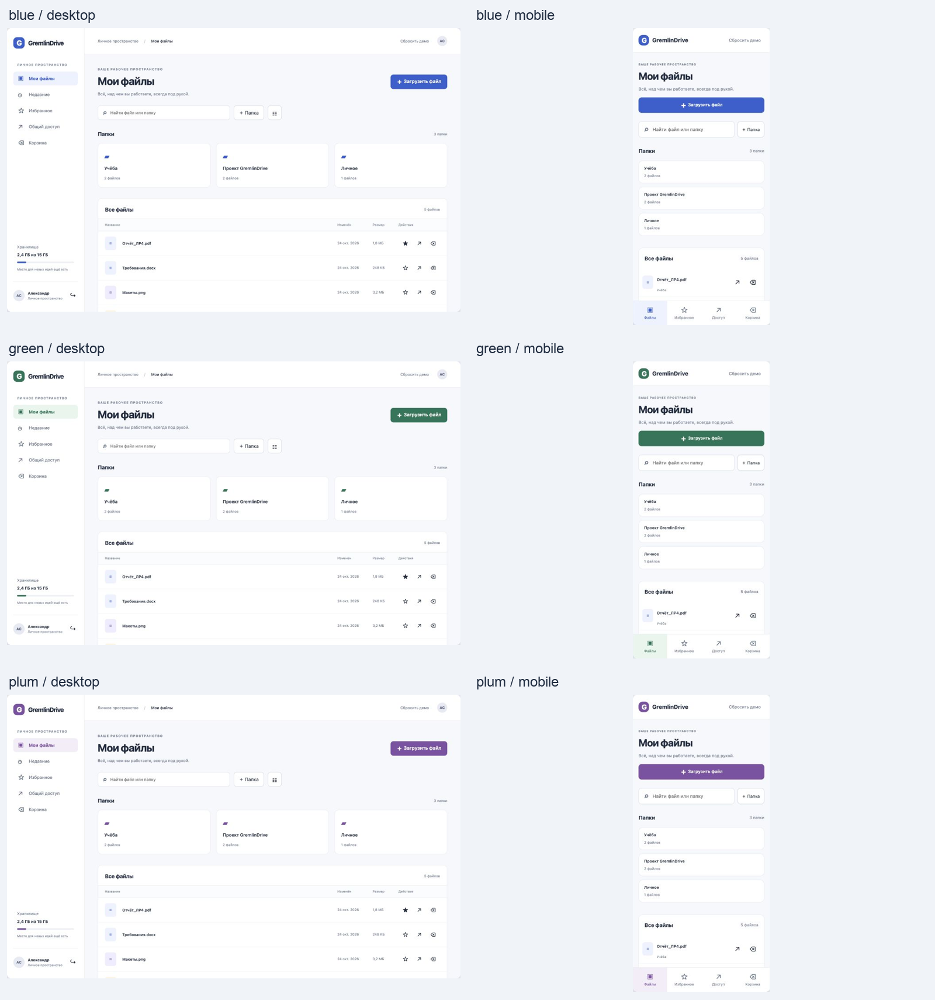
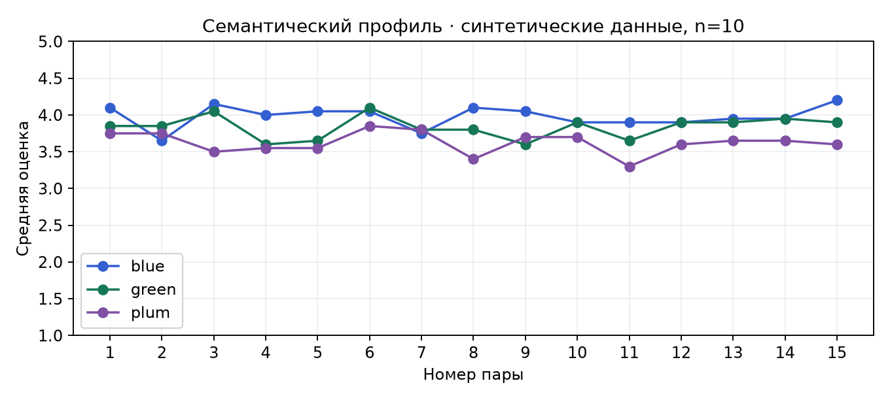
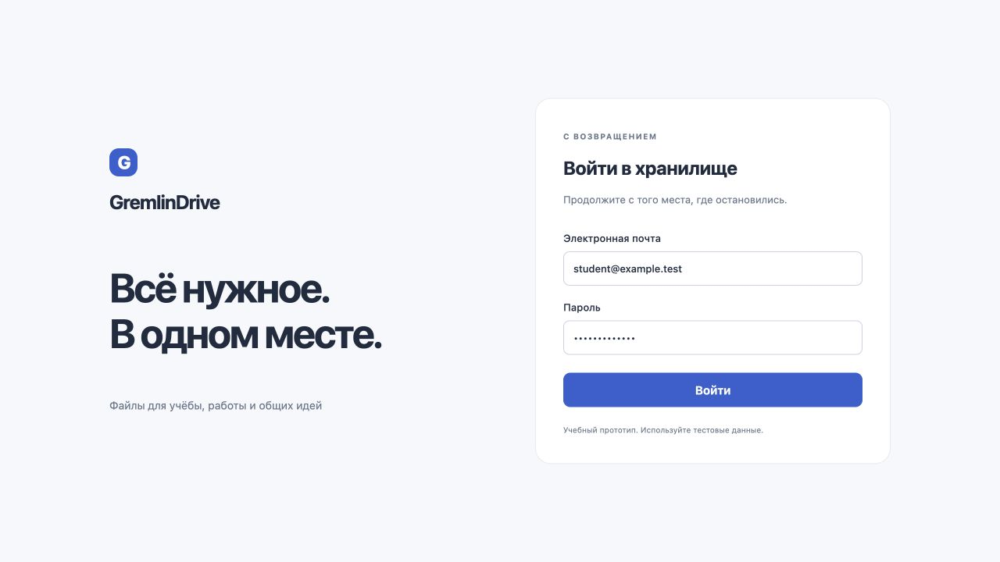
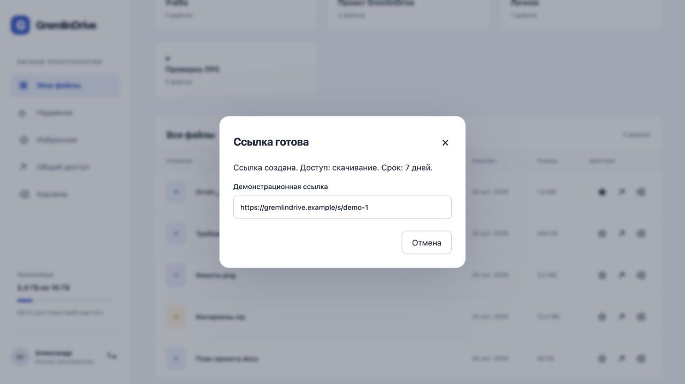
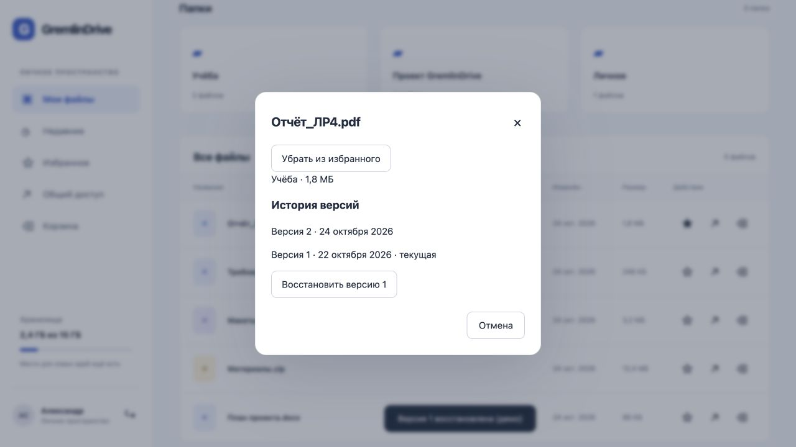
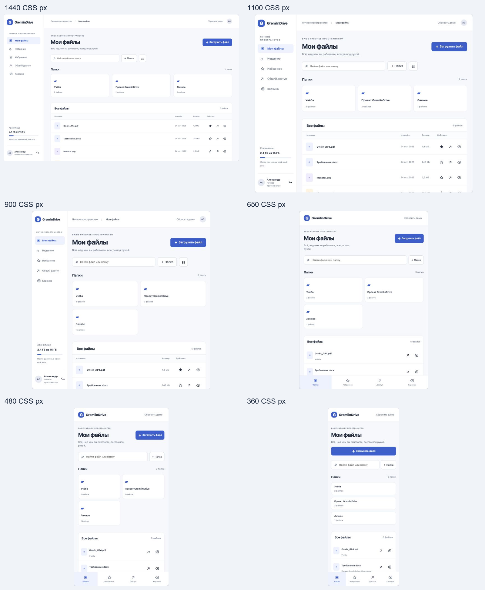
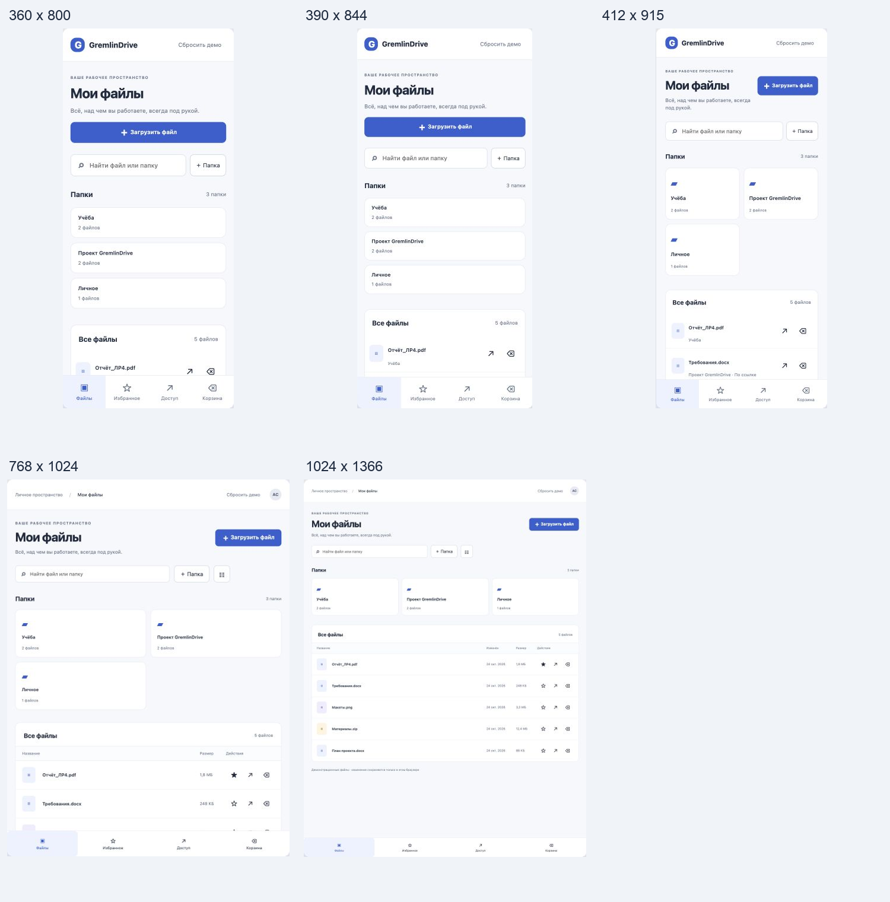

# 1 Цель и исходные материалы

Цель работы - выбрать визуальный язык GremlinDrive и подготовить интерактивные прототипы веб- и мобильного приложения. Работа продолжает сценарии файлового хранилища из ЛР3 и контракт API из ЛР4: личные файлы, папки, поиск, общий доступ, версии и корзина.

Использованы методические указания «ПЧМИ ЛабРабота5 2024-2025.pdf», скачанные из актуального задания №575 на учебном портале 24 октября 2026 года. В репозитории сохранены исходники, изображения, данные и сценарий повторного расчёта.

Оценки дизайна в этой работе смоделированы для дополнительного учебного задания. Реального опроса не было. S01-S10 - идентификаторы десяти синтетических профилей, а не людей. Набор нужен, чтобы показать сбор таблицы, построение семантического профиля и выбор варианта по заданному правилу. Он не подтверждает предпочтения аудитории.

# 2 Поиск визуального решения

Для файлового хранилища важнее быстро узнать документ и понять следующее действие, чем украсить каждую карточку. Поэтому в качестве основных паттернов взяты боковая навигация на широком экране, нижняя навигация на телефоне, поиск над содержимым и отдельное основное действие загрузки. Папки собраны выше списка файлов. Таблица превращается в карточки без горизонтальной прокрутки.

Примеры из методических указаний использованы как ориентиры для композиции, типографики и состояния элементов. Отдельно проверен принцип достаточного контраста по W3C WCAG 2.2, SC 1.4.3: для обычного текста нужен коэффициент не ниже 4,5:1. Проверка основных цветовых пар приведена в ЛР6. Это частичная проверка, а не заявление о полном соответствии WCAG.

Подготовлены три решения с одинаковой геометрией. Blue использует спокойный синий #345FD1, Green - зелёный #167658, Plum - фиолетовый #8050A5. Цвет меняется через theme=blue, theme=green или theme=plum. Во всех вариантах сохранены подписи, размеры и расположение кнопок, чтобы при сравнении менялась именно палитра.

# 3 Семантический дифференциал

Для каждого варианта использованы 15 пар антонимов. Значение 1 означает левый полюс, 5 - правый; 3 - нейтральное впечатление. Порядок полюсов одинаков во всех строках, поэтому высокое значение можно сравнивать напрямую. Нельзя переносить эти средние на реальные предпочтения пользователей.

|№|Левый полюс (1)|Правый полюс (5)|
|---|---|---|
|1|сложный|простой|
|2|хаотичный|упорядоченный|
|3|перегруженный|лаконичный|
|4|устаревший|современный|
|5|неприятный|приятный|
|6|тусклый|выразительный|
|7|неуверенный|надёжный|
|8|чужой|привычный|
|9|тяжёлый|лёгкий|
|10|раздражающий|спокойный|
|11|нечитабельный|читабельный|
|12|непоследовательный|целостный|
|13|холодный|дружелюбный|
|14|отвлекающий|сосредоточенный|
|15|любительский|профессиональный|

Один профиль оценивал все три палитры на двух платформах. Всего в semantic.csv находится 10 × 3 × 2 × 15 = 900 оценок. Генератор использует фиксированное зерно 20261024, индивидуальную склонность к высоким или низким оценкам, предпочтение одной палитры и случайный разброс. У фиолетового варианта отдельно повышается ожидаемая выразительность и дружелюбность. Схема генерации открыта в scripts/model_study.py. В каждой строке стоит data_origin=synthetic.

Для пары j среднее равно сумме десяти ответов, делённой на 10. Итог палитры - среднее по 15 парам. Так как число оценок в ячейках одинаковое, это совпадает со средним всех 150 ответов одной палитры на одной платформе. Выбирается вариант с наибольшим итогом отдельно на desktop и mobile.

|Палитра|Desktop, 1-5|Mobile, 1-5|
|---|---|---|
|blue|4.087|3.873|
|green|3.9|3.767|
|plum|3.72|3.527|

По принятому правилу выбран Blue. Разница с Green небольшая, поэтому в реальном исследовании стоило бы повторить проверку с независимой выборкой. В учебной модели выбор лишь показывает способ принятия решения. График объединяет две платформы; подробные значения по каждой платформе сохранены в исходной таблице.

## Индивидуальные средние по палитрам

|Профиль|Blue|Green|Plum|
|---|---|---|---|
|S01|4.07|3.53|3.63|
|S02|3.57|3.63|3|
|S03|4.27|4.1|3.8|
|S04|4.17|4.2|3.5|
|S05|4.17|4.43|4.03|
|S06|4.17|4|4.37|
|S07|3.4|3.73|3.27|
|S08|3.53|3.4|3.03|
|S09|4.07|3.27|3.27|
|S10|4.4|4.03|4.33|

# 4 Интерактивный прототип

Прототип реализован на HTML, CSS и JavaScript, без внешних библиотек. Это позволяет открыть его в обычном браузере и проверить формы с клавиатуры. Мобильная версия использует тот же сценарий, но сохраняет нижнюю навигацию и на планшете через параметр mobile=1. Отдельного нативного приложения в этой работе нет.

После входа доступны создание папки, фильтрация файлов, загрузка демонстрационных метаданных, избранное, общий доступ, история версий и восстановление из корзины. Изменения хранятся в localStorage. Кнопка «Сбросить демо» возвращает исходный набор. Авторизация демонстрационная: проверяется формат почты и длина пароля, запрос к серверу не отправляется. Следует использовать только тестовые реквизиты.

Для новой папки проверяются пустое название, длина до 80 символов и совпадение существующего имени без учёта регистра. Для ссылки можно задать срок 1, 7 или 30 дней и пароль от восьми символов. Ссылка имеет домен example и не предоставляет настоящий доступ к файлу. Файлы в списке и данные о квоте демонстрационные.

Удаление сначала показывает подтверждение, затем переносит файл в корзину. Восстановление возвращает его в прежнюю папку. История версий открывается нажатием на название файла. В прототипе меняется отметка текущей версии; содержимое документа не хранится и не восстанавливается. Поиск, корзина и избранное показывают отдельное пустое состояние.

# 5 Адаптивность

Проверены шесть ширин веб-интерфейса: 1440, 1100, 900, 650, 480 и 360 CSS px. Они покрывают диапазоны из методических указаний. Для мобильной версии подготовлены пять размеров: 360×800, 390×844, 412×915, 768×1024 и 1024×1366. Это контрольные размеры телефонов и планшетов без заявления о проверке конкретных физических устройств.

Снимки получены во встроенном браузере Codex. Для воспроизводимого размера использовался iframe с указанными CSS-шириной и высотой. Внешняя рамка уменьшает изображение только после расчёта внутренней раскладки. Это проверка браузерной адаптивности, а не тест на реальных устройствах. Исходные полноразмерные снимки рамки приложены отдельно.

При ширине до 767 px исчезает боковая панель, появляется нижнее меню, а дата и размер файла убираются из строки. При ширине до 399 px папки идут в одну колонку, кнопка загрузки занимает всю ширину. Избранное на телефоне доступно из карточки файла, чтобы не сжимать две основные кнопки строки.

# 6 Руководство по стилю

Полная страница находится в prototype/styleguide.html. Основные правила одинаковы для web и mobile: светлый фон #F6F8FC, белые поверхности, основной текст #202C40, вторичный #68768B, акцент #345FD1 и цвет нажатия #2449AB. Состояния дополнительно обозначаются подписью или значком, а не только цветом.

Шрифт системный: -apple-system, BlinkMacSystemFont, Segoe UI, sans-serif. Заголовок web - 34 px, на телефоне - 29 px. Вспомогательные подписи мельче основного текста; это место стоит проверить отдельно на реальном устройстве. Отступы основаны на шаге 4 px, радиус карточек 13 px, полей 8-9 px. Рабочая область не растягивается бесконечно и ограничена 1500 px.

Основные кнопки и области действий имеют размер от 44×44 px. Tab перемещает фокус, Enter отправляет форму, Escape закрывает диалог. Видимый фокус задан контуром 3 px. Используются нативные label, dialog, required и minlength. Уведомления доступны через role=status. При prefers-reduced-motion отключается плавная прокрутка.

# 7 Проверка и результат

Реально выполнены ручные проверки во встроенном браузере: вход, создание папки, поиск, создание ссылки, удаление, просмотр корзины, восстановление и открытие истории версий. Отдельно проверены все контрольные размеры. Измерения в data/layout-checks.json для ЛР6 подтверждают отсутствие горизонтального переполнения: scrollWidth равен ширине экрана во всех 11 случаях. Минимальный размер видимых кнопок действий строки - 44×44 px. При проверке исправлены слишком узкие кнопки, обрезанное название папки и сетка на небольшом экране.

Получены интерактивные веб- и мобильный прототипы, три палитры, семантический профиль и руководство по стилю. Оценки восприятия остаются учебной симуляцией. Для подтверждения выбранного дизайна потребуется отдельное исследование с реальными людьми.

# 8 Файлы и запуск

Из каталога docs/labs достаточно выполнить python3 -m http.server 8056. Адрес прототипа: http://127.0.0.1:8056/lab5/prototype/. Мобильный режим: тот же адрес с ?mobile=1. Публичная версия: https://fpmi-hci-2026.github.io/GremlinDrive/labs/lab5/prototype/.

Исходные данные находятся в data/semantic.csv, сводка - data/summary.json. Для повторного расчёта нужен Python и matplotlib: python3 scripts/model_study.py. Независимая проверка расчётов: python3 ../lab6/scripts/verify.py. Архив содержит оба каталога lab5 и lab6, так как расчёты связаны.

# Источники

ПЧМИ ЛабРабота5 2024-2025.pdf. Методические указания из задания №575: https://edufpmi.bsu.by/mod/assign/view.php?id=575.

Материалы проекта GremlinDrive, ЛР3 и ЛР4: docs/labs/lab3 и docs/labs/lab4 в репозитории fpmi-hci-2026/hci-10-project-group-4.

W3C. Understanding SC 1.4.3: Contrast (Minimum). https://www.w3.org/WAI/WCAG22/Understanding/contrast-minimum.html. Дата обращения: 24.10.2026.
