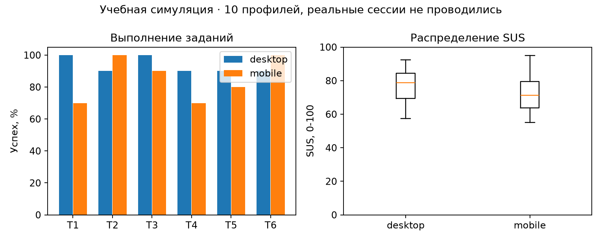

# 1 Цель и границы работы

Цель работы - проверить прототип GremlinDrive несколькими методами и сравнить варианты трёх форм. Использованы методические указания «ПЧМИ ЛабРабота6 2024-2025.pdf» из актуального задания №595 на учебном портале и прототип ЛР5.

Пользовательская часть выполнена как учебное моделирование: десять синтетических профилей S01-S10, а не реальные участники. Время заданий, ответы SUS, ожидания и карточная сортировка сгенерированы. Реальных сессий и записей пользователей нет. Отдельно проведена настоящая техническая и экспертная проверка прототипа во встроенном браузере. Эти два вида результатов не смешиваются.

Внешний сервис Treejack не запускался. Подготовлены дерево для импорта, задания и локальный инструмент tree.html; результаты data/tree_results.csv - симуляция теста дерева. Поэтому пункт методических указаний о проведении исследования непосредственно в Treejack остаётся невыполненным. Локальный инструмент не называется результатом Treejack.

# 2 План usability-тестирования

План для будущего исследования: дать участнику тестовую учётную запись и одинаковый набор файлов, попросить выполнять задачи без подсказок, затем заполнить SUS. На desktop используется мышь и клавиатура, на mobile - касания. Перед каждой задачей восстанавливается исходный набор. Фиксируются завершение, время, ошибки и оценка лёгкости SEQ от 1 до 7.

В моделировании один и тот же профиль представлен на обеих платформах. Время зависит от темпа профиля, сложности задачи и платформы; неудачная попытка обычно длиннее успешной. Это проектные допущения генератора. Они не являются наблюдениями за поведением людей и не позволяют оценивать реальные различия между платформами.

|Код|Задание|Критерий успеха|
|---|---|---|
|T1|Войти с тестовыми реквизитами|Открыт список файлов|
|T2|Создать папку «Новая_папка1»|Папка видна в списке|
|T3|Найти файл «Макеты.png»|В выдаче остался нужный файл|
|T4|Создать ссылку с паролем demo123456 на 7 дней|Показана ссылка и срок|
|T5|Вернуть предварительно удалённый файл|Файл снова доступен в прежней папке|
|T6|Найти прошлую версию отчёта|Открыта история версий|

Таймер для T1 запускается на готовом экране входа, для T2-T6 - на главном экране. Он останавливается при достижении критерия. Для реального исследования принят предел 120 секунд; после него попытка считается неуспешной. В синтетическом наборе нет цензурированных попыток с превышением этого предела. Время неуспешных попыток хранится, но не входит в медиану успешных.

# 3 Показатели производительности

Успех равен числу завершённых задач, делённому на число попыток. В каждой ячейке 10 попыток, поэтому один профиль меняет результат на 10 процентных пунктов. Медиана времени считается отдельно по успешным попыткам. Это позволяет не смешивать время выполнения с временем отказа.

|Задача|Desktop: успех|Время, с|Mobile: успех|Время, с|
|---|---|---|---|---|
|T1|10/10|18.1|7/10|21.5|
|T2|9/10|27.1|10/10|30.2|
|T3|10/10|21.4|9/10|28.3|
|T4|9/10|37.8|7/10|56.0|
|T5|9/10|36.2|8/10|49.9|
|T6|9/10|31.2|10/10|36.5|

Все значения таблицы - синтетические. Общие показатели приведены ниже; SEQ также смоделирован и не считается фактической удовлетворённостью пользователей.

|Платформа|Успех всех задач|Ошибки, сумма|SEQ, среднее|
|---|---|---|---|
|desktop|56/60|29|5.43|
|mobile|51/60|28|5.08|

Для обсуждения после задачи подготовлены вопросы: что мешало найти действие, какой результат ожидался, где потребовалось вернуться назад и что хотелось бы изменить в первую очередь. Ответы на открытые вопросы не выдумывались. В наборе нет фиктивных цитат или описаний наблюдений от имени участников.

# 4 SUS

Анкета содержит десять утверждений из методических указаний, с чередованием положительных и отрицательных формулировок. Ответы от 1 до 5. Нечётные пункты дают x-1, чётные - 5-x; сумма умножается на 2,5. Получается шкала 0-100, а не процент успешных действий. Русские формулировки приведены в QUESTIONNAIRES.md и служат рабочим переводом для учебного задания.

|Профиль|Desktop SUS|Mobile SUS|
|---|---|---|
|S01|92.5|95.0|
|S02|75.0|72.5|
|S03|57.5|60.0|
|S04|85.0|70.0|
|S05|60.0|67.5|
|S06|92.5|95.0|
|S07|67.5|62.5|
|S08|82.5|80.0|
|S09|77.5|77.5|
|S10|80.0|55.0|

|Платформа|Среднее|Минимум|Максимум|
|---|---|---|---|
|desktop|77.0|57.5|92.5|
|mobile|73.5|55.0|95.0|

Пример S01 desktop: вклады пунктов 4, 4, 3, 3, 4, 4, 3, 4, 4, 4. Сумма 37, итог 92.5. Независимый скрипт verify.py пересчитывает каждую строку. Синтетические средние не доказывают реальную удобность прототипа и не сравниваются с нормами как результаты полевого исследования.

# 5 Обратная карточная сортировка

Для офлайн-проверки подготовлено дерево разделов и четыре карточки: восстановить удалённое, открыть предыдущую версию, найти созданные ссылки, перейти к избранному. Участник должен положить карточку в ожидаемый раздел. Те же задания использует локальный tree.html. Дерево в data/tree-import.txt можно перенести в сервис тестирования дерева, но запуск сервиса в этой работе не проводился.

Успех означает выбор целевого узла. Прямой успех означает правильный выбор без возврата к корню и переходов в ошибочные ветви. В синтетической таблице direct не может быть больше success. Источник каждой строки указан как local_tree_simulation_not_Treejack.

|Задача|Desktop успех/прямо|Mobile успех/прямо|
|---|---|---|
|C1|10/10; 9/10|9/10; 7/10|
|C2|10/10; 9/10|9/10; 6/10|
|C3|10/10; 8/10|9/10; 6/10|
|C4|9/10; 8/10|10/10; 9/10|

В офлайн-варианте оценивается только попадание карточки в категорию. Для сравнения используется тот же смоделированный выбор узла; это повторная обработка набора, а не второе независимое исследование. Наиболее полезная гипотеза для будущей проверки - различают ли люди «Общий доступ» как список ссылок и «Поделиться» как действие над конкретным файлом. Ещё одна гипотеза касается истории версий внутри карточки файла.

# 6 Тестирование ожиданий

До показа результата участнику предлагаются четыре вопроса: что произойдёт после поиска, что откроет «Общий доступ», что можно увидеть в истории версий и куда вернётся файл после восстановления. Эталонные ответы заданы по поведению прототипа: фильтрация списка, список файлов со ссылками, список версий и прежняя папка соответственно.

В симуляции хранится только бинарное совпадение ожидаемого поведения с этим эталоном. Неверные текстовые ответы не создавались. Ниже количество совпадений из десяти; реальные ожидания могут отличаться.

|Элемент|Desktop|Mobile|
|---|---|---|
|E1|10|9|
|E2|9|8|
|E3|7|7|
|E4|10|9|

Чтобы сократить возможное расхождение, стоит подписать список как «Созданные ссылки», а в карточке файла явно показать «История версий». В подтверждении восстановления полезно показывать папку назначения. Эти предложения основаны на устройстве интерфейса и заданных гипотезах, а не на вымышленных высказываниях людей.

# 7 Экспертная проверка по контрольным спискам

Эта часть выполнена по настоящему прототипу. Пройденные сценарии проверены во встроенном браузере; программные свойства подтверждены чтением исходников. Чеклист не является полной сертификацией доступности.

|Версия|Пункт|Результат|
|---|---|---|
|Web|Вход ведёт к файлам|Пройдено в браузере|
|Web|Созданная папка появляется в списке|Пройдено в браузере|
|Web|Поиск оставляет подходящие имена|Пройдено в браузере|
|Web|Ссылка показывает выбранный срок|Пройдено в браузере|
|Web|Удаление требует подтверждения|Пройдено в браузере|
|Web|Корзина позволяет вернуть файл|Пройдено в браузере|
|Web|Версии доступны из имени файла|Пройдено в браузере|
|Web|Формы имеют label, required, minlength|Проверено по исходникам|
|Mobile|Есть нижняя навигация|Проверено на снимках пяти размеров|
|Mobile|Видны название и основные действия|Проверено на снимках|
|Mobile|Области основных действий от 44 px|Исправлено в CSS|
|Mobile|Нет тесных трёх колонок на 360 px|Исправлено: одна колонка|
|Обе|Диалог имеет закрытие и Escape|Нативный dialog; Escape проверен|
|Обе|Серверная авторизация и реальная передача|Вне границ демонстрационного прототипа|
|Обе|Работа со скринридером и физическим телефоном|Не проверялась|

Для основных пар палитры коэффициент контраста рассчитывается через относительную яркость sRGB: (Lсветл+0,05)/(Lтёмн+0,05). Подробный расчёт и значения сохранены в data/contrast.csv. Проверены основной и вторичный текст, белый текст на кнопке, текст на фоне и активная навигация. Проверка нескольких пар не покрывает каждую подпись и каждое состояние.

# 8 GOMS: три формы, два варианта, два метода ввода

Цели: войти в хранилище, создать папку и создать ссылку. Операторы: K - клавиша или нажатие кнопки мыши, P - наведение, H - перенос руки между мышью и клавиатурой, M - умственная подготовка. Из методических указаний взяты K=0,2 с, P=1,1 с, H=0,4 с, M=1,35 с. Время ответа системы R исключено: модели сравнивают локальное действие при одинаковом ответе системы.

Метод мыши: навести указатель, нажать поле, перенести руку для ввода, вернуться к мыши и подтвердить действие. В форме входа это повторяется для двух полей, поэтому H=4. Смешанный метод: открыть форму мышью, перейти к вводу, затем использовать Tab и Enter. Правило выбора: вариант B предпочтителен при известной пользователю задаче; вариант A оставлен как исходное решение с двумя промежуточными переходами. Варианты показаны в forms.html.

Для одинакового ввода приняты 36 символов входа (20 в почте student@example.test и 16 в пароле laboratory123456), 12 символов названия «Новая_папка1» и 10 символов пароля demo123456. Это тестовые значения модели. Пароль при входе в прототип можно менять; настоящие реквизиты не используются.

В A добавлены два P и два K на промежуточные переходы. M задаётся по группам принятия решения: вход и папка - 3 в A и 2 в B; ссылка - 4 в A и 2 в B. Это аналитическое допущение. Для ссылки смешанная стратегия включает два наведения и шесть служебных нажатий помимо символов пароля. Все итоги используют T=0,2K+1,1P+0,4H+1,35M.

|Форма|Вариант/ввод|Выражение|Время, с|
|---|---|---|---|
|Вход|A/mouse|41K + 5P + 4H + 3M|19.35|
|Вход|A/mixed|41K + 3P + 1H + 3M|15.95|
|Вход|B/mouse|39K + 3P + 4H + 2M|15.4|
|Вход|B/mixed|39K + 1P + 1H + 2M|12.0|
|Новая папка|A/mouse|17K + 5P + 2H + 3M|13.75|
|Новая папка|A/mixed|16K + 3P + 1H + 3M|10.95|
|Новая папка|B/mouse|15K + 3P + 2H + 2M|9.8|
|Новая папка|B/mixed|14K + 1P + 1H + 2M|7.0|
|Ссылка с паролем|A/mouse|17K + 7P + 2H + 4M|17.3|
|Ссылка с паролем|A/mixed|18K + 4P + 1H + 4M|13.8|
|Ссылка с паролем|B/mouse|15K + 5P + 2H + 2M|12.0|
|Ссылка с паролем|B/mixed|16K + 2P + 1H + 2M|8.5|

Получены все 12 моделей. Выигрыш B заложен сокращением переходов и числа решений, поэтому результат не следует трактовать как эмпирическое доказательство. На реальном интерфейсе его надо проверить на выполнении задачи и числе ошибок. KLM здесь оценивает обученного пользователя без ошибок, тогда как синтетические task time выше из-за поиска и неопределённости.

# 9 Мобильная KLM-модель

Для телефона использована адаптация KLM с T - касанием, K - вводом символа и M - подготовкой. Принято T=K=0,2 с как явное допущение модели, а не измеренная скорость касания. Свайпы, сетевой ответ, подсказки и исправление ошибок в эти три простые формы не включены. Отсчёт начинается с доступного действия открытия формы.

|Форма|K / T / M|Оценка, с|
|---|---|---|
|Вход|36 / 3 / 2|10.5|
|Новая папка|12 / 3 / 2|5.7|
|Ссылка с паролем|10 / 5 / 2|5.7|

Формула: 0,2×(K+T)+1,35×M. Если принять касание равным 0,4 с, каждая оценка увеличится на 0,2×T; это показывает чувствительность результата к допущению. Модель пригодна для сравнения числа действий, но не заменяет измерение времени на реальном телефоне.

# 10 Рекомендации и результат

В первую очередь следует сделать подписи общего доступа и истории версий более явными, затем проверить их на реальных задачах. Для длинного списка пригодятся сортировка и путь к папке назначения при восстановлении. Небольшие подписи и работа диалогов требуют проверки на физическом телефоне со скринридером и увеличенным шрифтом.

Техническая проверка помогла исправить мобильную сетку и размеры действий. Подготовлены инструменты исследования, синтетические таблицы производительности и SUS, модель карточной сортировки и ожиданий, 12 GOMS-расчётов и три мобильные модели. Числа открыты и пересчитываются. Ограничения: нет реальных участников, физического мобильного теста и запуска Treejack. Следующим этапом должно стать фактическое исследование по приложенному протоколу.

# 11 Воспроизводимость

Данные: data/performance.csv, sus.csv, tree_results.csv, expectancy.csv, goms.csv, mobile_klm.csv и PROVENANCE.json. Генератор: ../lab5/scripts/model_study.py. Проверка: python3 scripts/verify.py. Проверяющий скрипт независимо пересчитывает SUS, средние, медианы, успех и обе операторные модели. Поле data_origin не позволяет спутать синтетический набор с фактическим исследованием.

# Источники

ПЧМИ ЛабРабота6 2024-2025.pdf. Методические указания из задания №595: https://edufpmi.bsu.by/mod/assign/view.php?id=595. Константы KLM и методика SUS взяты из этого файла.

ПЧМИ ЛабРабота5 2024-2025.pdf; исходники и отчёт ЛР5 GremlinDrive.

W3C. Understanding SC 1.4.3: Contrast (Minimum). https://www.w3.org/WAI/WCAG22/Understanding/contrast-minimum.html. Дата обращения: 24.10.2026.
